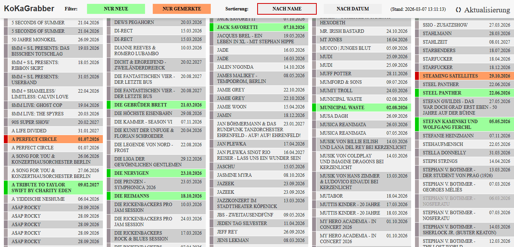

# KoKaGrabber

## About

KoKaGrabber is a simple project to grab the event list from several concert ticket providers. For better overview it highlights events added in the last 24 hours or since last visit. Favourites can be marked to remember which tickets to later buy in bulk.

The following providers are included:

* koka36.de (R.I.P.)
* Eventim
* LoveYourArtist
* MyTicket
* Ticketmaster



## Features

* pulls all music concert events (for Berlin) from providers
* list view of all concerts
  * new events are highlighted
  * events on wishlist are marked
* filters to show only new/wishlisted events
* sorting by artist name or by date

## Requirements

The tool uses SQLite as database backend. On Debian GNU/Linux this can be installed using

```
apt install php-sqlite3
```

## Legal

KoKaGrabber is distributed under the GPL, see LICENSE.